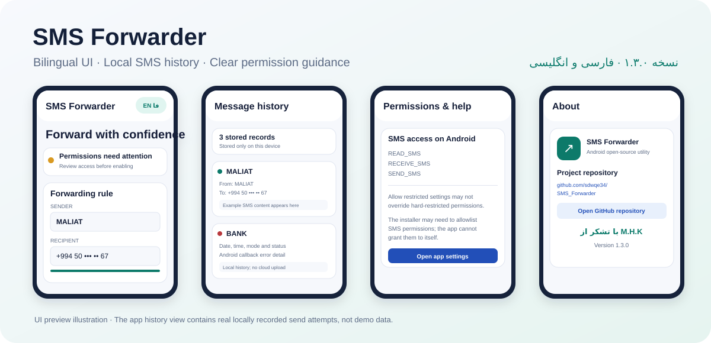
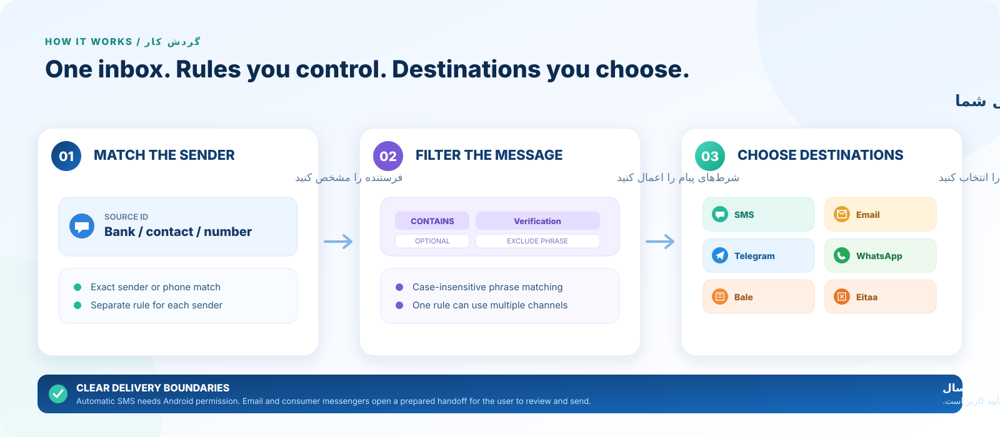

# SMS Forwarder 1.4.0 | فوروارد پیامک

  
  
<b>Route matching messages to the destinations you choose.</b>

  
<b>پیام‌های منطبق را با قوانین دلخواه به مقصدهای انتخابی منتقل کن.</b>

**English:** SMS Forwarder is an open-source Android utility for creating independent forwarding rules. A rule can match a sender, optionally include or exclude message text, and route a matching message to one or more selected channels. The interface supports Persian and English.

**فارسی:** «SMS Forwarder» ابزاری متن‌باز برای اندروید است که اجازه می‌دهد چند قانون مستقل انتقال پیام بسازی. هر قانون می‌تواند فرستنده را مشخص کند، شامل یا مستثنا بودن یک عبارت را بررسی کند و پیام منطبق را به یک یا چند روش انتخابی بفرستد. رابط برنامه فارسی و انگلیسی است.

> **Delivery clarity / شفافیت ارسال:** SMS can be sent automatically only when Android grants the required permissions. Email and consumer messenger channels create a notification and open a prepared, user-confirmed handoff; they do not silently send messages in the background. SMS send callbacks and local handoff records are not proof that the final recipient received a message.

> **شفافیت ارسال:** ارسال خودکار پیامک فقط در صورت اعطای مجوزهای لازم از سوی اندروید امکان‌پذیر است. برای ایمیل و پیام‌رسان‌ها، اعلان و متن آماده ایجاد می‌شود و کاربر باید مقصد را بررسی و ارسال را تأیید کند؛ این کانال‌ها در پس‌زمینه و بدون تأیید کاربر پیام نمی‌فرستند. وضعیت callback پیامک یا ثبت واگذاری محلی نیز اثبات نمی‌کند که گیرنده پیام را دریافت کرده است.

## Screens & workflow | نماها و روند کار

  

The illustrations are editorial product diagrams, not screenshots of a running device. Labels and example destinations in the diagrams are illustrative; the rules and destinations shown on the phone are configured by the user.

تصویرها، نمودارهای توضیحی و کاتالوگی هستند و اسکرین‌شات واقعی از گوشی نیستند. نام‌ها و مقصدهای نمونه صرفاً جنبه‌ی تصویری دارند؛ قانون‌ها و مقصدهای واقعی در برنامه را کاربر تعیین می‌کند.

## What's new in 1.4.0 | امکانات نسخه ۱.۴.۰

| English | فارسی |
|---|---|
| **Multiple independent rules:** configure different senders and recipients without overwriting one global rule. | **چند قانون مستقل:** برای فرستنده‌ها و مقصدهای متفاوت، قانون جدا تعریف کن. |
| **Optional content filters:** route only messages containing a phrase, and/or exclude messages containing another phrase. Matching is case-insensitive. | **فیلتر متن اختیاری:** فقط پیام‌های دارای یک عبارت را منتقل کن و/یا پیام‌های دارای عبارت دیگر را مستثنا کن؛ بررسی متن به بزرگی و کوچکی حروف حساس نیست. |
| **Choose one or multiple channels per rule:** SMS, Email, Telegram, WhatsApp, Bale and Eitaa. | **انتخاب یک یا چند کانال برای هر قانون:** پیامک، ایمیل، تلگرام، واتساپ، بله و ایتا. |
| Dedicated Rules page to add, edit, enable, pause and delete rules. | صفحه‌ی اختصاصی «قوانین» برای افزودن، ویرایش، فعال‌سازی، توقف و حذف قانون‌ها. |
| Non-SMS forwarding handoffs with an Android notification, message preview and explicit user confirmation. | واگذاری انتقال غیرپیامکی با اعلان اندروید، پیش‌نمایش پیام و تأیید صریح کاربر. |
| Local history for SMS send attempts and notification-based channel handoffs. | تاریخچه‌ی محلی برای تلاش‌های ارسال پیامک و واگذاری انتقال به کانال‌های دیگر. |
| Existing single-rule settings are retained and represented in the Rules manager when a user starts using the new rule model. | تنظیمات قانون تک‌گانه‌ی قبلی حفظ می‌شود و با شروع استفاده از مدل جدید، در مدیریت قوانین نیز نمایش داده خواهد شد. |
| Persian/English interface and clearer permission guidance. | رابط فارسی/انگلیسی و راهنمای شفاف‌تر مجوزها. |

## Channels: what actually happens? | رفتار واقعی کانال‌ها

- **SMS:** the app calls Android's SMS service for matching messages when <code>RECEIVE_SMS</code> and <code>SEND_SMS</code> are granted. Carrier restrictions, device policies, SIM state and Android's restricted-permission rules can prevent this.
- **Email:** tapping the notification opens an email composition screen addressed to the configured email address, with a subject and message text where supported by the selected email app.
- **Telegram, WhatsApp, Bale and Eitaa:** tapping the notification attempts to open the selected app with the message text. The user must verify or choose the actual conversation/recipient and tap Send. Recipient handles are not guaranteed to be preselected, and the flow can fall back to Android's share chooser if the target app is unavailable or does not support the handoff intent.

- **پیامک:** برنامه برای پیام‌های منطبق از سرویس SMS اندروید استفاده می‌کند؛ مشروط بر اینکه مجوزهای <code>RECEIVE_SMS</code> و <code>SEND_SMS</code> اعطا شده باشند. محدودیت اپراتور، دستگاه، سیم‌کارت و قوانین مجوزهای اندروید ممکن است مانع ارسال شود.
- **ایمیل:** با لمس اعلان، صفحه‌ی نوشتن ایمیل برای آدرس تنظیم‌شده باز می‌شود؛ موضوع و متن در صورت پشتیبانی برنامه‌ی ایمیل پر می‌شوند.
- **تلگرام، واتساپ، بله و ایتا:** اعلان تلاش می‌کند برنامه‌ی انتخاب‌شده را با متن پیام باز کند. کاربر باید گفت‌وگو یا گیرنده‌ی واقعی را بررسی/انتخاب کند و دکمه‌ی ارسال را بزند. تضمینی نیست که شناسه‌ی مقصد از قبل انتخاب شود؛ اگر برنامه‌ی مقصد نصب نباشد یا از روش واگذاری پشتیبانی نکند، امکان استفاده از انتخاب‌گر اشتراک‌گذاری اندروید وجود دارد.

These consumer-app handoffs are **not official API integrations** and must not be described as guaranteed background delivery. Reliable unattended sending through third-party services would require a supported service API, authentication and appropriate server-side or provider configuration.

این روش‌ها **اتصال رسمی به API پیام‌رسان‌ها نیستند** و نباید به‌عنوان ارسال تضمینی در پس‌زمینه معرفی شوند. برای ارسال خودکار قابل اتکا از طریق سرویس‌های ثالث، API پشتیبانی‌شده، احراز هویت و پیکربندی متناسب با ارائه‌دهنده لازم است.

## Setup | راه‌اندازی

1. Install and open SMS Forwarder.
2. Open **Rules / قوانین**, then select **Add a rule / افزودن قانون جدید**.
3. Enter the sender number or sender ID exactly as it appears in your inbox. Phone-number comparison also normalizes common formatting differences.
4. Optionally add a phrase that the message must contain and/or a phrase it must not contain.
5. Select one or more channels and provide a destination for each selected channel. For messenger apps, the configured destination is a helpful label/handle; confirm the actual recipient inside the messenger before sending.
6. Save the rule. Use the switch on the rule card to pause or enable it; use Edit or Delete to maintain your rules.
7. Grant the relevant permissions. On Android 13 and later, allow notifications so non-SMS handoffs can appear.
8. Open **History / سوابق** to review send attempts, message content, destinations and Android callback/handoff status.

۱. برنامه را نصب و باز کن.
۲. وارد تب **قوانین** شو و گزینه‌ی **افزودن قانون جدید** را بزن.
۳. شماره یا شناسه‌ی فرستنده را مطابق صندوق پیامک وارد کن. مقایسه‌ی شماره تلفن اختلاف‌های رایج در قالب شماره را نیز در نظر می‌گیرد.
۴. در صورت نیاز عبارتی را وارد کن که پیام باید شامل آن باشد و/یا عبارتی را مشخص کن که نباید در پیام وجود داشته باشد.
۵. یک یا چند روش ارسال را انتخاب و برای هر روش یک مقصد وارد کن. برای پیام‌رسان‌ها، مقصد ثبت‌شده صرفاً نام/شناسه‌ی راهنماست؛ پیش از ارسال، گیرنده‌ی واقعی را داخل پیام‌رسان بررسی کن.
۶. قانون را ذخیره کن. با کلید روی کارت قانون می‌توان آن را متوقف یا فعال کرد؛ گزینه‌های ویرایش و حذف نیز در دسترس‌اند.
۷. مجوزهای لازم را فعال کن. در اندروید ۱۳ و بالاتر، برای نمایش واگذاری‌های غیرپیامکی مجوز اعلان‌ها را نیز بده.
۸. در تب **سوابق**، تلاش‌های ارسال، متن پیام، مقصدها و وضعیت callback پیامک یا واگذاری به کانال دیگر را بررسی کن.

## Permissions & Android limitations | مجوزها و محدودیت‌های اندروید

The app uses SMS and Contacts permissions for its core inbox, sender matching and SMS-sending features. Android may treat <code>READ_SMS</code>, <code>RECEIVE_SMS</code> and <code>SEND_SMS</code> as restricted permissions, depending on the platform version and installation source. An ordinary app cannot grant or allowlist these permissions for itself. Turning off Samsung Auto Blocker or enabling **Allow restricted settings** is not a guaranteed fix.

این برنامه برای قابلیت‌های اصلیِ صندوق پیامک، تطبیق فرستنده و ارسال SMS از مجوزهای پیامک و مخاطبین استفاده می‌کند. بسته به نسخه‌ی اندروید و منبع نصب، مجوزهای <code>READ_SMS</code>، <code>RECEIVE_SMS</code> و <code>SEND_SMS</code> ممکن است محدودشده باشند. برنامه‌ی عادی نمی‌تواند خودش این مجوزها را به خودش اعطا یا allowlist کند. خاموش‌کردن Auto Blocker سامسونگ یا فعال‌کردن **Allow restricted settings** راه‌حل تضمین‌شده‌ای نیست.

### If SMS permissions are unavailable

1. Open **Settings → Apps → SMS Forwarder → Permissions** and inspect the SMS permissions shown by Android.
2. Allow Contacts and Notifications separately if needed.
3. If SMS permissions do not appear or cannot be granted, repeated prompts or reinstalling the same APK may not help. Use an installation/distribution channel that is permitted to grant the relevant restricted permissions.
4. Do not root the phone, disable device security or install unknown APKs to bypass the restriction.

### اگر مجوز پیامک در دسترس نیست

۱. مسیر **تنظیمات ← برنامه‌ها ← SMS Forwarder ← مجوزها** را باز و مجوزهای پیامک نمایش‌داده‌شده را بررسی کن.
۲. در صورت نیاز، مجوزهای مخاطبین و اعلان‌ها را جداگانه فعال کن.
۳. اگر مجوز SMS نمایش داده نمی‌شود یا قابل اعطا نیست، درخواست مکرر یا نصب دوباره‌ی همان APK ممکن است مشکلی را حل نکند. از مسیر نصب/توزیعی استفاده کن که اجازه‌ی اعطای مجوزهای محدودشده را دارد.
۴. برای دورزدن محدودیت، گوشی را root نکن، امنیت دستگاه را خاموش نکن و APK ناشناس نصب نکن.

Helpful Android documentation:
- [Change app permissions](https://support.google.com/android/answer/9431959?hl=en)
- [Restricted settings](https://support.google.com/android/answer/12623953?hl=en)
- [Android runtime permissions](https://source.android.com/docs/core/permissions/runtime_perms)

## History & privacy | تاریخچه و حریم خصوصی

- Rules and history are stored locally in app-private storage; this code does not upload them to a service.
- Up to 500 history entries are retained; older entries are dropped when the limit is exceeded.
- History can contain message bodies, sender IDs, phone numbers, email addresses and recipient labels. Treat it as sensitive information.
- SMS status reflects Android send callbacks, not a carrier delivery receipt.
- Non-SMS handoffs stay in a waiting/queued state until the user acts in the target app; this app cannot know whether the user eventually pressed Send or whether a third-party service delivered the message.
- The app does not declare the Internet permission. Carrier SMS charges may apply.

- قوانین و سوابق به‌صورت محلی در فضای خصوصی برنامه ذخیره می‌شوند؛ این کد آن‌ها را به سرویس آنلاین ارسال نمی‌کند.
- حداکثر ۵۰۰ سابقه نگهداری می‌شود و در صورت عبور از این سقف، رکوردهای قدیمی حذف می‌شوند.
- تاریخچه می‌تواند متن پیام، شناسه‌ی فرستنده، شماره تلفن، آدرس ایمیل و نام مقصد را شامل شود؛ بنابراین اطلاعات حساس محسوب می‌شود.
- وضعیت SMS بر اساس callback اندروید است، نه رسید تحویل اپراتور.
- واگذاری‌های غیرپیامکی تا زمان اقدام کاربر در حالت انتظار می‌مانند؛ برنامه نمی‌تواند بفهمد کاربر در نهایت دکمه‌ی ارسال را زده یا سرویس ثالث پیام را تحویل داده است.
- برنامه مجوز اینترنت را در Manifest اعلام نمی‌کند. هزینه‌ی پیامک اپراتور ممکن است اعمال شود.

## Download | دریافت برنامه

- **Latest published binary at the time of this source update:** [SMS-Forwarder-1.3.0.apk](https://github.com/sdwqe34/SMS_Forwarder/releases/download/v1.3.0/SMS-Forwarder-1.3.0.apk)
- **Release page and checksum:** [GitHub Release v1.3.0](https://github.com/sdwqe34/SMS_Forwarder/releases/tag/v1.3.0)
- **Builds and CI:** [GitHub Actions](https://github.com/sdwqe34/SMS_Forwarder/actions/workflows/android.yml)
- **Source code:** [sdwqe34/SMS_Forwarder](https://github.com/sdwqe34/SMS_Forwarder)

The source configuration is being prepared as version **1.4.0**. The existing v1.3.0 APK does not include the new rules and channel handoffs. Install only builds you trust and understand the permissions they request.

در زمان این به‌روزرسانی، فایل عمومی منتشرشده همچنان نسخه‌ی **۱.۳.۰** است و قابلیت‌های جدید نسخه‌ی منبع ۱.۴.۰ را ندارد. فقط نسخه‌هایی را نصب کن که به منبع آن‌ها اعتماد داری و مجوزهای درخواستی‌شان را می‌شناسی.

## Build from source | ساخت از سورس

Requirements: JDK 17 and Gradle 8.7. Open <code>SmsForwarder/</code> in Android Studio or run:

    cd SmsForwarder
    gradle --no-daemon clean :app:assembleDebug

The debug APK is generated at <code>SmsForwarder/app/build/outputs/apk/debug/app-debug.apk</code>. This is a debug-signed testing build, not a production-signed Play Store package.

برای ساخت، JDK 17 و Gradle 8.7 لازم است. پوشه‌ی <code>SmsForwarder/</code> را در Android Studio باز کن یا دستورهای بالا را اجرا کن. فایل APK در مسیر <code>SmsForwarder/app/build/outputs/apk/debug/app-debug.apk</code> ساخته می‌شود. این فایل با امضای Debug برای آزمایش است و بسته‌ی امضاشده‌ی تولیدی برای Play Store نیست.

## About | درباره

- **Repository:** [sdwqe34/SMS_Forwarder](https://github.com/sdwqe34/SMS_Forwarder)
- **License:** [MIT](LICENSE)
- **Source version:** 1.4.0
- **Credit:** با تشکر از M.H.K

## License | مجوز

MIT — see [LICENSE](LICENSE).  
مجوز MIT — متن کامل در فایل [LICENSE](LICENSE) قرار دارد.
